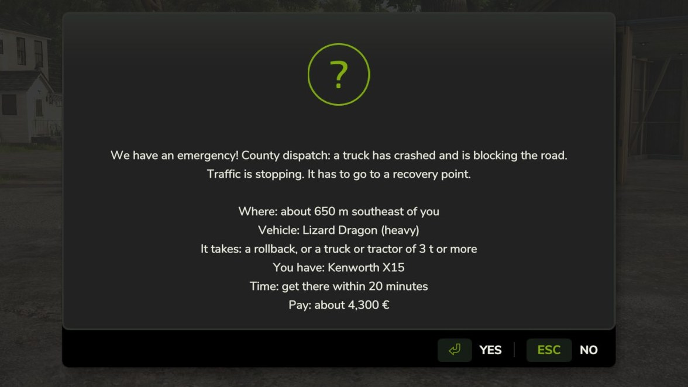
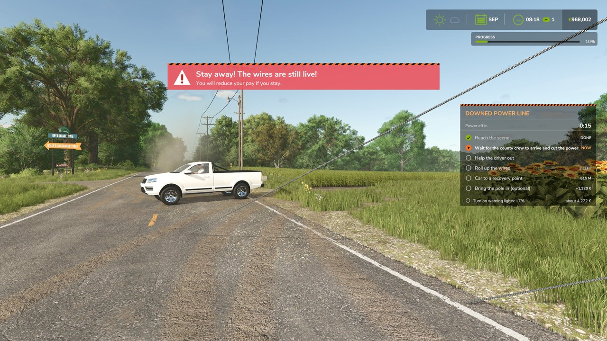
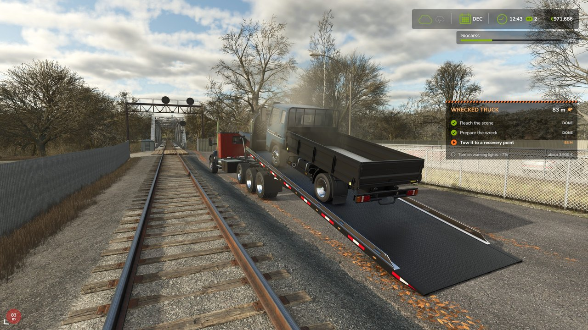
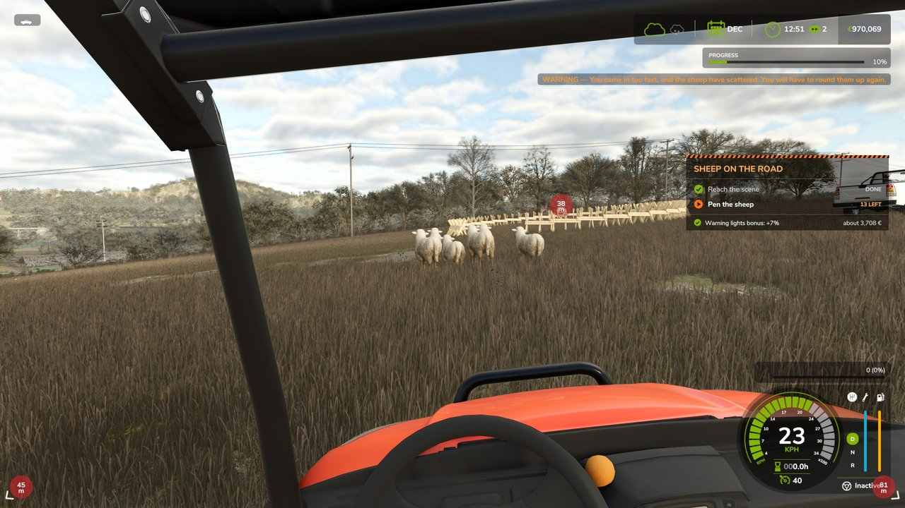
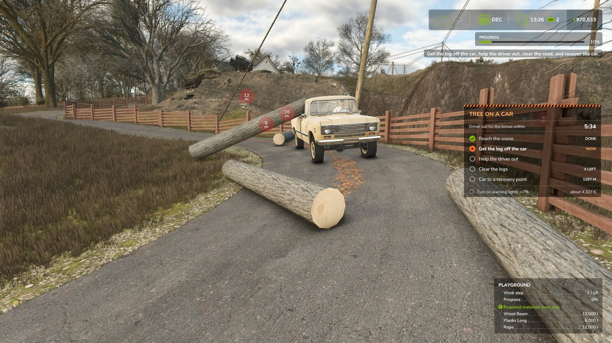
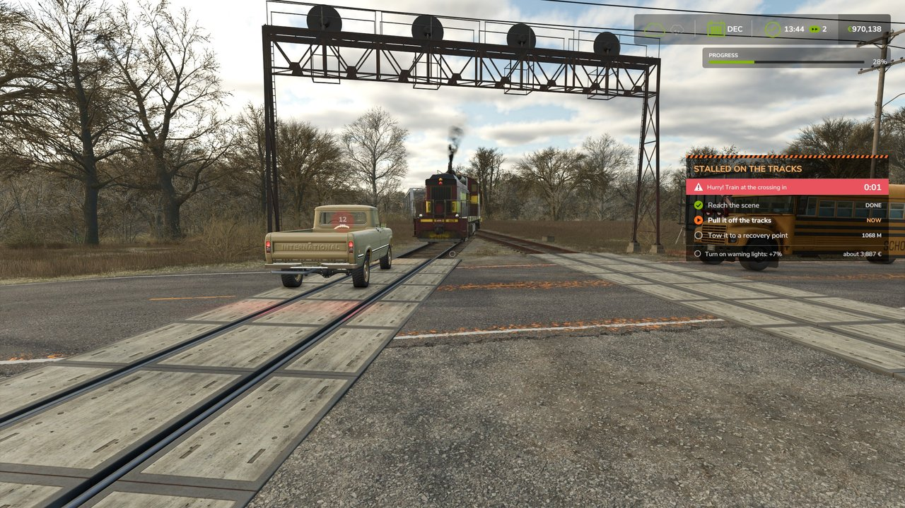

# Roadside Emergencies for Farming Simulator 25

> [!IMPORTANT]
> **This mod requires the free [Emergency Pack](https://store.steampowered.com/app/4651570) DLC.** Install it, and select it together with this mod when you start your savegame. Without it, no calls come.

**Your pager goes off: a deer is lying in the lane and traffic is backing up. You drive out, clear the road with whatever you own, and get paid.**

Adds 19 new callouts to the free [Emergency Pack](https://store.steampowered.com/app/4651570) DLC: you are the local contractor county dispatch calls when something goes wrong on the road. These aren't contracts you pick from a list. The calls come to you, from anywhere on the map's roads.

### [Download the latest version](https://github.com/Corencas/FS25_RoadsideEmergencies/releases/latest/download/FS25_RoadsideEmergencies.zip)

[All releases](https://github.com/Corencas/FS25_RoadsideEmergencies/releases) · [Report a bug](https://github.com/Corencas/FS25_RoadsideEmergencies/issues/new/choose)

Free · Public beta · FS25 on PC (tested on Windows) · Single player only for now · **Requires the free Emergency Pack DLC** · English and German

| | |
|:---:|:---:|
|  |  |
| **The pager tells you everything before you answer** | **A downed power line: stay clear until the county crew cuts the power** |
|  |  |
| **Reel a wreck onto a rollback, or tow it with what you own** | **Drive the flock into the farmer's pen** |
|  |  |
| **A tree on a car: get the log off before the door will open** | **Stalled on the tracks, and the train is on its way** |

## Install

1. **Required:** get the free **Emergency Pack** DLC if you don't have it: [Steam](https://store.steampowered.com/app/4651570), or [your store](https://www.farming-simulator.com/dlc.php?lang=en).
2. Download `FS25_RoadsideEmergencies.zip` with the link above. **Don't use GitHub's green Code button:** that file won't load in the game.
3. Put the zip in `Documents/My Games/FarmingSimulator2025/mods`. Don't extract it, and keep its name.
4. Tick this mod **and the Emergency Pack** for your savegame. It's a beta, so copy your savegame first.

The only official download is this page. Copies anywhere else may be old or changed.

## Your first call

1. Play. County dispatch calls by itself every so often. The pager says where the call is, what is there, what it takes, which of your vehicles can do it, how long you have and about what it pays. Answer **Yes** and follow the map marker. The **call panel** at the right of the screen lists the job's steps and ticks them off as you go.
2. On foot, press **H** for the guide and the settings, and **F1** to see the keys that apply right now.
3. Clear the road, bring what you find to a drop-off or recovery point, and get paid.

## Help test this beta

So far it has been played on one PC, so other maps, mod lists and machines are what it needs most. Finishing any job and saying how it went helps.

- [Report a bug or a job that went wrong](https://github.com/Corencas/FS25_RoadsideEmergencies/issues/new?template=bug_report.yml)
- [Say how it works with another mod](https://github.com/Corencas/FS25_RoadsideEmergencies/issues/new?template=compatibility_report.yml)

Attach `log.txt` from `Documents/My Games/FarmingSimulator2025`, and copy it **before you restart the game**, because the game overwrites it.

## Emergencies

| Call | What you do |
|---|---|
| **Roadkill:** deer, wild boar | Drag it off the road by hand, or load it and take it to a drop-off point |
| **Hit livestock:** pigs, sheep, goats | The same; there are usually several |
| **Hit livestock:** cattle, horses, water buffalo | Too heavy to drag: strap them to a vehicle or lift them with a machine |
| **Wrecked truck** | Prepare it for recovery on foot, then tow it to a recovery point |
| **Downed power line** | Stay back while the county crew drives up and cuts the power, then get the driver out and the car away and roll up the wires. Bringing in the pole is optional and pays extra |
| **Tractor rollover** | Help the driver out, pull the tractor back onto its wheels, recover it |
| **Overturned trailer** | Two jobs, do one or both: right the trailer and bring it in, and bring in the spilled bales. Both earn a bonus |
| **Livestock trailer crash** | A livestock trailer on its side. Two jobs, do one or both: catch the loose animals and clear the dead, and right the trailer and bring it in. Both earn a bonus |
| **Storm damage** | After the game's twister: bring the bales it blew across the road to a recovery point |
| **Railroad crossing** | A stalled vehicle on the tracks and the train on its way. Only a strap or a winch line moves it: ramming it does nothing. It can be any crossing near you, and the further away it is, the more time you get. Pull it clear in time, then take it to a recovery point. If the train gets there first, the job is lost |
| **Car in the water** | A car off the road in shallow water, with the driver inside. Wade out for the driver, pull the car up the bank with a strap or a winch, and take it to a recovery point. Only on maps with shallow water and a gentle bank beside a road |
| **Tree on a car** | A storm has dropped a tree on a car, with the driver on the horn inside. Get the log off the car with a chainsaw, a strap or whatever you have, and the door will open. Help the driver out, clear the road, and take the car to a recovery point. Quick work earns a bonus |
| **Flock on the road** | Sheep all over the road, and a pen the farmer has put up nearby. They start in bunches along the road and move straight away from you, in a vehicle or on foot. Round them up and steer them to the gate of a pen well off the road. Slow down near them, or they scatter |
| **Logging crash** | A timber trailer on its side and its logs across the road. The owner's crew sees to the trailer. Clear every log off the road: load it onto a truck or trailer, or drag it well off to the side, with log forks, a crane or a strap. A chainsaw makes them smaller. When the job is done the crew takes all the logs. If you hand it over early, the logs on your vehicle are yours |

Calls come from anywhere on the map's roads, so one can come from right next to you. The animals lie scattered across the road, differently
every time, and traffic stops behind them until the road is clear.

## You only get calls you can finish

This is a firm rule. If your farm doesn't have what a job takes, that call doesn't come at all. Dispatch checks every vehicle you own or lease before each call, so if the pager asks, you have what it takes. Buy or sell a vehicle and your calls change with it.

| With this | You can get |
|---|---|
| **Nothing at all** | Deer, boar, sheep, pigs and goats in the road, which you drag by hand, and driving a flock, which you can do on foot |
| **A pickup truck, or any motorized vehicle of 1 t or more** | Also cows, horses and buffalo, cars in the water, trees on cars, power lines, logging crashes, railroad crossings and smaller overturned trailers |
| **A tractor, a truck, or any motorized vehicle of 3 t or more** | Also wrecked trucks, overturned tractors, and the bigger vehicles on the other jobs |

Some calls take one thing more. Big bales need a bale fork, bale grab, bale loader or forklift. Storm damage needs a trailer or a pickup bed. A livestock trailer crash needs your own livestock trailer.

The pager still says what a job takes before you answer, because what you own may be at the other end of the map. Saying no costs nothing.

## How the pay works

**Animals**

- Load them on any vehicle and you get the full call pay when the road is clear.
- Only moving them to the roadside takes under a minute and pays very little.
- Delivering an animal to a drop-off point pays for the haul-off, minus the site's disposal fee.

| Example (before the game's economy difficulty) | Call pay | Delivery |
|---|---|---|
| One deer, loaded | $600 | +$209 pay, -$45 fee |
| One deer, only moved to the roadside | $125 | none, unless you come back for it |
| Two cows, loaded | $1,413 | +$808 pay, -$188 fee, each |

**Left behind:** an animal left lying anywhere is your responsibility. You get a warning and a map marker, and reminders with 15 and 5 minutes to
go. After 30 minutes of play, which only count while you are more than 20 m away, the county collects it and bills you: a deer $165, a cow $451. If you
were paid to haul it and never delivered it, the bill includes that pay. Leftover animals don't stop new calls.

**Wrecks and spilled loads** must reach a recovery point before the job ends. The pay comes then: a truck $3,500, a tractor $4,500, storm damage $1,200 plus the bales. A wreck also pays $500 per kilometer from the scene to the nearest recovery point. An overturned trailer pays $3,000 plus that distance for the trailer, and each bale on top, with a 25% bonus for doing both.

**A downed power line** has two parts: the car ($2,500 plus the distance) and the wires ($100 each), with a 25% bonus for doing both. Bringing the pole in is optional: $1,200 more, if it is in before the rest is done. Staying too close while the power is on cuts your pay by 10%.

**Spilled bales** come in two kinds, and the call tells you which:

- **Small bales** (most calls): 6 to 12 of them. Each pays $45 if you also bring in the trailer, and $75 if the bales are all you bring in or on a storm job. You can carry them by hand into a pickup bed, or into the trailer once it is back on its wheels and tow it all in, so one vehicle can do the job.
- **Big bales:** 3 or 4 on a trailer job, because that is what the trailer can carry, and 3 to 8 on a storm job, where you bring your own trailer. Each pays $220 if you also bring in the trailer, and $300 if the bales are all you bring in or on a storm job. They need a front loader or a telehandler.

Each bale that reaches a recovery point pays, even if you hand over the rest of the job in the settings (`H`).

**Livestock trailer crash** has two parts, paid separately, and you choose:

- **The trailer:** $3,000 plus the distance when it reaches a recovery point. It only needs something that can pull.

- **The animals:** the dead ones pay as on an animal call, and each live one you load pays $75. The live ones are then yours to sell. This needs a livestock trailer of your own.
- **Both:** 25% on top of everything. Two dead sheep, four live ones and the trailer come to $4,985, plus the distance.

Once you have finished one part, another contractor takes the other after 10 minutes without progress, or sooner if you choose it in the settings (`H`). You are paid for what you did.

**Bonus:** warning lights at the scene (beacons or hazards on any of your vehicles that really has them), kept on for 20 seconds in all, earn 7% extra.

**A call you don't reach** within 20 minutes goes to another contractor. If you said yes and a job ends with no pay, because you missed it, handed it over or lost it to the train, you are charged a tenth of its pay. Saying no on the pager costs nothing. **Saving during a call** is fine: it comes back when you load.

**Railroad crossing:** $3,000 and $500 per kilometer to the recovery point, once it is there. Nothing if the train gets there first.

**Car in the water:** $3,000 and $500 per kilometer to the recovery point, once it is there.

**Tree on a car:** $2,500, $200 a log and $500 per kilometer to the recovery point, once the car is there, and a $500 bonus for getting the driver out within 6 minutes. If you hand it over, you are paid for what you have done: the logs you cleared, the bonus if you earned it, and the car if it is in.

**Flock on the road:** $1,200 and $150 for each sheep, once they are all in. If you hand it over, $150 for each one in the pen.

**Logging crash:** $1,200 once every log is clear of the road, plus $300 for each of the 5 to 9 logs. If you hand it over, you are paid for the logs you cleared.

## Handling animals and wrecks

**Loose animals** wander off slowly, stop now and then to graze, and shy away when you come close. Walk up to one and use the activate key to catch it: it follows you on a lead you can see. Walk it next to your own
livestock trailer and use the key again to load it. You can lead one at a time, and it gets away if you run too far ahead. Each one has a pin and a map marker, and traffic stops for those on the road.

Animal bodies work like bales, so anything that handles bales handles them: front loaders, forks, grabs, cranes, any trailer, tension belts,
UniversalAutoload, and winch mods that hook objects, such as Better Winch. You can pile several up before delivering.

- A cow is about 650 kg, so a small crane trailer can't lift one.
- The base-game winch only hooks trees; use the strap or a winch mod.
- Dead animals can't be sold, opened, wrapped or fed to animals.

**Recovery strap (`K` on foot):** aim at a spot on an animal or a prepared wreck and press `K`: the strap hooks exactly there. Aim at a vehicle and press
`K` again to attach the other end, or at nothing to put the strap away. Where you hook matters: to right a tractor, hook it high on its upper side and
pull it over the top. A wreck on its side stays put until the strap goes tight, so right it with the strap, not a winch mod. Straps on animals stay on when you save.

**Towing a wreck:** a wreck's engine stays off, because it's wrecked. The strap pulls nothing until you reel it or drive off, so you can hold `N` and `M` to put a wreck on a rollback or in another position first. It brakes by itself when the strap goes slack, so it stops when you stop. The strap hooks where you aim, pulls along the line, and reaches 20 m, and the wheels at that end follow the line, so that end of the wreck comes straight to your vehicle. Once you drive off with the strap tight, it closes up to a short hitch about a meter behind your vehicle, and the wreck follows like a trailer, by either end, so a small pickup can tow a car down the road. Back up and it lets go instead of being pushed, and it hitches up again when you pull away. By hand you can reel it down to under a meter. For a rollback, hook the strap to the wreck, attach it to the head of the bed, and hold `N` to reel it on. If the wreck stands crooked, pull at an angle first to line it up with the bed. A trailer can't steer, so while you reel, it moves over toward the line: attach the strap to one side of the bed to bring it over that way.

**Wrecks can't be reset.** The game's reset would be a free trip to the shop, so its menus don't offer it for a wreck. If a wreck vanishes anyway (the game itself resets a vehicle that fell out of the world), it doesn't count as brought in, and another contractor takes over the job.

**A downed power line:** while the power is on, a red warning with a hazard sign stays on the screen as long as you are too close to the wires; stay there and your pay is cut by 10%. The poles stand on open ground beside the road, never on farmland or in a building. Once you are there, the county crew's truck comes along the road from out of sight, parks short of the scene with its hazards on, and the crew cuts the power; the call panel shows about how long that takes. If it is held up in traffic it parks where it is, and the power goes off in any case. You can't drive the county crew's truck. The prompts on the wires and the car say when it isn't safe yet. Once the power is off, a pin shows each wire and each piece of the pole. Hold the activate key anywhere along a wire to roll it up: let go and it stops, hold again and it goes on. The pole is a real log, so anything that handles logs handles it, and the chainsaw cuts it where it lies: stand beside it and aim across it.

**Drop-off and recovery points:** the shop, plus any you add in the settings. A steady map marker shows them while you have something to bring.

**Scene kit (`U` on foot, at a call):** traffic cones, wooden barricades and cones with barrier tape, free and unlimited, each placed by hand. They stop
traffic. Whatever you place during a job, you pick up again: until you do, the county keeps calling and no new call comes.

## Mods that work well with this one

None are required, and [the full list](docs/COMPATIBLE_MODS.md) says what has been tried. Tested: the [International CV Rollback](https://roughneckmoddingcrew.itch.io/fs25-cv-rollback) (a full wreck job) and the [T880 Rollback](https://roughneckmoddingcrew.itch.io/t880-rollback) by Roughneck Modding Crew (pull a wreck onto the bed with the strap and the reel keys, belt it down, and drive it in), [Better Winch](https://thundrfs.itch.io/fs25-better-winch) by ThundR, and UniversalAutoload by loki_79. The full list, with what still needs a test, is in [docs/COMPATIBLE_MODS.md](docs/COMPATIBLE_MODS.md).

### Compatibility notes

Every place the mod touches the game is listed in [docs/HOOKS.md](docs/HOOKS.md). The ones another mod might notice:

- **Saved logs:** the game loads cut pieces of a "transport" tree in the wrong place, so they fall off the map. Roadside Emergencies puts its own logs (logging crash, tree on a car, the power pole) back where they were saved. It doesn't touch any other logs.
- **Hand tools:** during one of its jobs, if switching hand tools does nothing and your hands are empty, it switches the tool itself. Other times it leaves the game's tool keys alone.
- **Its wrecks:** the vehicles it places as wrecks can't be entered, started or reset. Other vehicles aren't affected.
- **Map screen:** clicking one of its own map markers shows its buttons in the game's context box. Other markers work as before.

## Keys (on foot)

| Key | What it does |
|---|---|
| `K` | Recovery strap: hook, attach, remove |
| `N` (hold) | Recovery strap: reel in, when you are near one |
| `M` (hold) | Recovery strap: let out |
| `U` | Scene kit: open or close (only at a call) |
| `I` | Scene kit: next item |
| `L` | Scene kit: place, or pick up what you aim at |
| `O` (hold) | Scene kit: rotate |
| `H` | Settings: open or close (arrow keys and Enter inside) |

All of them can be changed in the game's controls menu, and the mod's texts name the key you chose. Every line of the mod's in the F1 help starts with "RSE:".

## Settings and guide (`H` on foot)

The first row opens the **in-game guide**: 21 pages on everything you need to know, from what each call takes to how the pay works, and a long page goes on over the next screen. The first time you play with the mod, a welcome dialog offers it and says where to report a bug. A new savegame starts with the settings you last used.

County dispatch calling by itself, how often calls come, animal calls, wreck calls, job size (small, normal, large or random: how many animals or bales), income, fees and bills, how
long until the county collects what you leave, how long until another contractor takes over, map markers, and the call panel. You can add your own drop-off points or remove the
nearest one (the row names it first), and return all the settings to default.

**How often calls come:** at least 30, 12 or 6 minutes of play after your last job ends (rarely, normal or often). Every kind of call is as likely as any other, so on Normal a big job (a wreck, a rollover, a crashed trailer, a livestock crash, a power line, a logging crash, a railroad crossing) comes about once an hour. Two big jobs never come within 30 minutes of each other.

While a job is running, one more row hands it to another contractor at any moment, for instance if a wreck gets stuck in water. You keep the pay for what you have
done on a livestock trailer crash, an overturned trailer, and for each bale that came in on a storm job; otherwise there is no pay.

Use the arrow keys: Up and Down choose a row, Left and Right change it, Enter confirms, and `H` or Esc closes.

## Map markers

Each has its own picture, on the map and the minimap:

| Marker | Means |
|---|---|
| Blue number (1 to 9) | Your own drop-off point, the same number as in the settings |
| Green animal | A loose animal |
| Red ! | A dead animal left behind |
| Orange cone | Each of your cones and barricades; it blinks when it is left from an earlier job |

Your own drop-off points only show while you are with something to bring to one. The shop has no marker of ours: the map already shows it.

**Click a marker on the map** to see what it is and teleport there. On a dead animal you can also have the county collect it now, for the usual bill, and on your own drop-off point you can remove it.

## FAQ

**Do I need the pack's fire trucks?** No. Dispatch calls you with whatever you own. It only offers what your farm can handle, and heavier jobs need a vehicle.

**Does it work without the Emergency Pack?** No, the pack is required. Without it no calls ever come, and a message tells you so when you load the savegame.

**Multiplayer?** Not yet. It's single player only for now.

**Consoles?** No. This download is for FS25 on PC.

**Which maps?** It has been tested on Riverbend Springs and on one modded map, Judith Plains, Montana 4X, with 289 mods running. Calls use the map's traffic roads, so other maps with traffic should work. If yours doesn't, please report it.

**Why don't I get railroad crossing calls?** They need a map with crossings, one within 2.5 km of you, and a train that isn't rented. Riverbend Springs has five.

**Which vehicles are the wrecks?** Base-game ones, different from call to call: five trucks, nine tractors, four trailers, two livestock trailers and four cars. The bigger ones come up less often. The pager says which one it is, and whether it takes a bigger vehicle or a rollback, before you answer.

**Can I take it out of a save?** Yes, the save still loads. Dead animals and cones are gone while the mod is off, and they came back when it was ticked again. That was tested without saving in between, so copy your savegame first if you plan to save without the mod.

**Can I make videos with it?** Yes. Show it, stream it and earn money from your videos as you like.

**Why did a stuck car disappear?** Traffic is run by the game. It stops for what is on the road, but the game can remove a vehicle that has been stuck for a long time.

**Other languages?** French, Spanish, Italian, Russian, Brazilian Portuguese, Polish, Czech and Ukrainian are planned for 1.0. The German texts are machine-drafted, and corrections from native speakers are welcome.

## Console commands

For testers and video makers, with the game's developer console enabled. `rseStart` is the quick way to try a job.

| Command | What it does |
|---|---|
| `rseHelp` | List the commands in the log |
| `rseDebug` | Turn debug logging on or off |
| `rseStart [emergency]` | Dispatch calls now: an animal, `wreck`, `rollover`, `trailer`, `livestock`, `powerline` or `storm`; none for a random one |
| `rseTwister` | Spawn the game's twister; a storm call follows when it ends |
| `rseCalls [on\|off]` | Show or switch the calls that come by themselves |
| `rseJobSize [small\|normal\|large\|random]` | Show or set how much work a call is |
| `rseFleet [pickup\|nothing\|off]` | What your farm can do and which calls that brings; `pickup` or `nothing`: as if that were all you owned |
| `rseVehicle [kind] [number]` | Test: list the vehicles a wreck can be, or choose the next one of a kind |
| `rseCarcass [animal] [count]` | Place dead animals 6 m ahead |
| `rseCarcassClear` | Remove every dead animal |
| `rseLeftSoon [seconds]` | Bring forward the county's collection |
| `rseExpireSoon [seconds]` | Bring forward another contractor taking over a call you haven't reached yet |
| `rseScene` | Log the scenes and where each animal is |
| `rseRoad` | Log the road where you stand |
| `rseKit [clear]` | Log the scene kit items, or remove them all |
| `rsePoints`, `rsePointAdd`, `rsePointRemove` | List, add or remove drop-off points |
| `rseFee [factor]` | Show or set the factor on fees and bills |
| `rseMarkers [on\|off]` | Show or switch the map markers |
| `rseState` | Log everything the mod tracks |

## Repository

| Folder | Contents |
|---|---|
| `mod/` | What ships: becomes `FS25_RoadsideEmergencies.zip` |
| `tests/` | Unit tests for the engine-free core (`lua5.1 tests/run.lua`) |
| `tools/` | Build, deploy, log and translation checks (Python 3) |
| `docs/` | [Every place the mod touches the game](docs/HOOKS.md), and [which mods work with it](docs/COMPATIBLE_MODS.md) |

See also the [changelog](CHANGELOG.md), [how to contribute](CONTRIBUTING.md) and the [credits](CREDITS.md).

## License

Free to play. You may play it, make videos and streams with it, and read its code. Please don't re-upload it, publish changed versions, or reuse its parts without asking. Links to this page are welcome. The full terms are in [LICENSE](LICENSE).

Not affiliated with or endorsed by GIANTS Software or Creative Mesh.

Built with [Claude Code](https://claude.com/claude-code).
